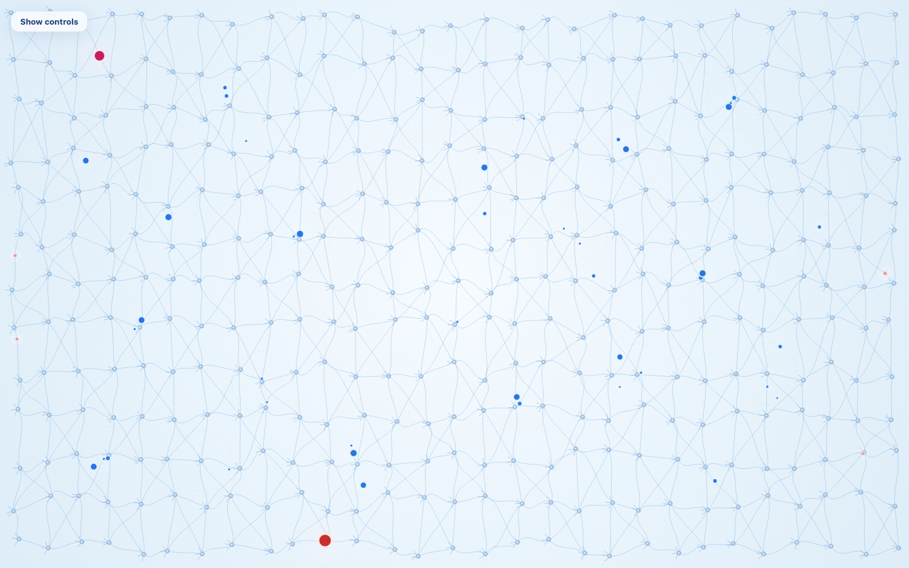
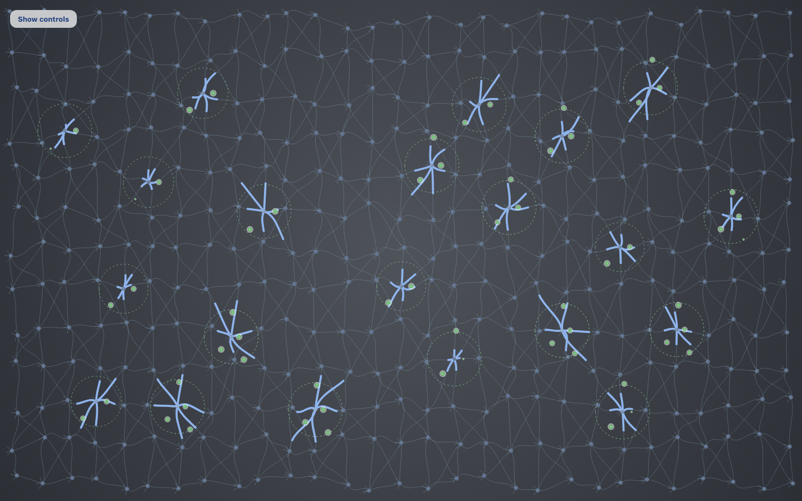

# Paper Life

**Purple crystallization variant.** On this branch a neuron does not thicken its axons. The same sleep deposit that used to raise axon strength now raises that neuron's crystallization, from 0 to 1. Saturation is the mean of those levels, so age still moves only while sleep crystallizes neurons, and peak saturation still never falls. A resting soma keeps its normal color; a partial level blends toward purple; a fully crystallized neuron (level 1, the old full-thickness mark) is soma `#6a1b9a` and nucleus `#ce93d8`. When a neuron reaches 1, its domain grows and adjoining neurons start to crystallize on later sleep deposits. Daytime still does not crystallize anything. Temporary orange homes, light-green permanent thoughts, blue internal thoughts, the sleep colors, the lust slider, and the scattered centers are unchanged. The sections below describe the thickening model this variant replaces; where they say thickness or a dark axon, read crystallization and purple.


Paper Life is one brain, drawn as a network, living from birth toward a saturation limit. Outside thoughts enter at the border, shrink as they travel, and sometimes find a temporary home. Internal thoughts answer from category centers. Sleep is automatic: kept homes fly to a permanent cluster, and only then does the brain lay down knowledge as thickness on the axons around that cluster. Age is that knowledge, not the clock.

Serve the `Paper-life` folder and open `index.html`. Paper.js 0.12.17 is loaded from the CDN, so a static server is required.

```
python3 -m http.server 8099 --bind 127.0.0.1
```

Then open `http://127.0.0.1:8099/`. A query string can seek, freeze, or expose diagnostics (see [URL parameters](#url-parameters-and-window__life)).

## The brain

377 neurons, the first Fibonacci number above 300, sit on a 29 by 13 grid. Each neuron is jittered by `mulberry32(23)` (at most 0.18 cells in x and 0.24 in y) and grows three dendrites. Neighbors are joined by 1,048 cubic Bézier axons: horizontal lanes, alternating diagonals, and vertical links, walkable in either direction. The bend of each axon is a hash of its endpoints.

The simulation lives in grid space, one unit per cell. The renderer scales that to the canvas. Nothing in the model depends on the pixel size.

Twenty-one of those neurons are category centers. They are chosen by continuing the same seeded shuffle, at least two cells in from the border, and at least about three grid cells apart. With this seed the separation that fits all 21 is 2.5 cells; the closest pair is about 2.83 cells apart. The centers are not arranged in rows.

## Outside thoughts

Three kinds enter from any of the four borders and walk inward.

| Kind | Odds | Regular size | Lifetime (s) | Color |
| --- | --- | --- | --- | --- |
| Danger | 16% | 1.8 | 9–13 | `#c62828` |
| Attraction | 18% | 1.6 | 8–12 | `#c2185b` |
| Everyday | the rest, 66% | 0.62 | 1.5–2.8 | `#ef9a9a` |

Spawn rate is 11 per simulated second, multiplied by the age stage's acceptance. Lifetime is also scaled by risk affinity, from 0.75× late in life to 1× at birth.

An accepted thought is drawn at 3.4× its regular size and shrinks along a fixed curve:

```
scale = 0.15 + (3.4 − 0.15) × (1 − age/ttl) ^ 1.35
```

That is 3.4 at entry and 0.15 at expiry. Opacity eases down over the last 28% of the life. A fresh everyday thought is therefore about 2.11 visual units; a fresh danger thought is about 6.12.

Three endings:

1. **Border rejection.** A familiar danger or attraction can be refused at the border. Lifetime is 0.22–0.38 seconds and the bead collapses to zero. No home, no wave, no internal thoughts.
2. **Temporary home.** The traveler meets an internal thought near a neuron other than that internal thought's source, and lust allows it. The traveler is removed. An orange crystal appears at exactly 2× the kind's regular size.
3. **Insignificant fade.** The thought finishes its path, or its lifetime ends, without a home. It shrinks to the fade size and is gone.



## Temporary homes

Orange is `#ff9800` with core `#fff3e0`, drawn at exactly 2× the kind's regular size, whatever size the traveler had shrunk to. A small blue partner bead sits beside a temporary home.

The moment of housing brushes the background with one wave. This is a metaphor, not a measurement.

| Kind | Wave | Colors |
| --- | --- | --- |
| Attraction | Reward | gold into rose |
| Danger | Stress | crimson into violet |
| Everyday | none | |

The wave lasts 0.9–1.3 seconds, expands across most of the screen, and fades. Overlapping waves share one opacity cap. The pool holds 16 waves. Ordinary housing, rejection, meditation, travel, settlement, and rebalancing emit none.

## Internal thoughts

Internal thoughts are blue (`#1d6fe3`, and `#5c9cff` once the background has gone dark). They never cause further internal thoughts.

- **Accepted thought, once.** A thought that passes the border and is accepted for housing (its housing roll is under lust/100) fires one burst as it starts traveling: exactly 7 blue thoughts, from 7 distinct category centers chosen by a hash. It does not fire again while it travels, shrinks, or later finds a home. A border rejection fires nothing. At meditation (lust 0) nothing is accepted for housing, so nothing fires.
- **Temporary or wandering home, on a timer.** Each such home has its own 3–6 second interval, hashed from its identity, so homes do not pulse together. Each tick emits 1, 2, or 3 internal thoughts from that many distinct centers, any of the 21. The timer runs while the home is temporary and while it wanders during sleep. It stops for good when the thought settles, or when sleep tosses it.
- A burst is atomic. Seven free slots, or the acceptance burst is dropped whole. Up to three free slots, or that tick is dropped whole. Drops are counted in `droppedInternalBursts`. A normal first day and first night drop none.

Each blue thought independently draws a size class, mixed inside the burst, not copied from the trigger:

| Class | Visual size |
| --- | --- |
| Medium | 1.15 |
| Large | 2.1 |
| Extra large | 3.4 |

It then shrinks to nothing:

```
size = initialScale × (1 − age/ttl) ^ 1.2
```

Awake lifetime is 2.6–4.2 seconds, 35% longer asleep, and shorter as the brain ages. Blue thoughts leave their centers on hashed headings and bounce inside the grid. They are recycled at the end of that life.

A blue thought and a traveler crystallize only while they are still close enough for their current sizes. The meeting distance uses the average of the two visible sizes, divided by the 3.4 entry scale.

When no new thought is being accepted and nothing is temporary or wandering, no new internal thoughts are created. Whatever is already flying finishes, and the mind goes quiet.

The counter pool holds 610 slots, a Fibonacci number. Over 400 simulated seconds and two nights the peak was 362 live blue thoughts, with zero dropped bursts. When more than 72 are on screen at once, their shared opacity is lowered. None are skipped.

## Lust for learning

The only control is a slider from Meditation (0) to Eager (100).

```
lustNatural = 100 × (1 − peakSaturation / 0.8)
```

clamped to 0–100. An empty brain rests at 100. As peak saturation approaches 80%, lust rests near 0. Natural lust moves only when peak saturation moves, and peak saturation moves only when sleep consolidates, so an awake bout holds lust still.

Dragging forces a value and holds it. On release it eases back toward natural with time constant 3.5 simulated seconds (`1 − e^(−dt/3.5)`). It counts as forced until it is within 0.5 of natural. `setLust` is the same nudge from code.

Housing chance equals lust/100.

- At 100, a meeting can crystallize, and every thought that passes the border fires the seven-center burst.
- At 0, meditation: thoughts still enter large, flow, shrink, and fade. No temporary home, no wave, no acceptance burst. A home that already exists keeps its 1–3 timer until it settles or is tossed.
- In between, the share of travelers accepted for housing, and therefore the share that fire the burst, equals lust/100.

## Age and knowledge

Saturation is the fraction of axon length covered by knowledge. Age is `100 × peakSaturation / 0.8`. Peak saturation never falls, so a night that concentrates wiring cannot make the brain younger.

Thickness deposited in sleep is scaled by growth. Age 0–100 is mapped onto 0–90 degrees:

```
growth = max(0.2, cos(age × 0.9°) − 0.0001)
```

Youth is near 1. The floor of 0.2 keeps late life from stalling. Life ends when peak saturation reaches 80% (within 0.001). The picture holds for 3 seconds, the veil fades in, and a new life begins.

Two filters ride the same progress, `peakSaturation / 0.8`. Filter strength is a smoothstep from 4% to 96% of that progress, and it scales how readily a familiar danger or attraction is refused at the border (chance from 0.15 to 0.55). Risk affinity is the complement and shortens lifetimes as it falls.

## Life stages

Sleep ratio, acceptance, and keep chance are interpolated between these anchors and clamped outside them. The stage name on the panel flips at the halfway point between anchors. The age labels on the age bar (Early childhood, Childhood, and so on) are a separate scale and are not these stages.

| Age | Stage | Sleep / awake | Acceptance | Keep |
| --- | --- | --- | --- | --- |
| 0 | Infant | 18 / 6 | 1.00 | 0.90 |
| 8 | Elementary | 12 / 12 | 0.70 | 0.72 |
| 16 | High school | 8 / 16 | 0.48 | 0.55 |
| 24 | Young adult | 6 / 18 | 0.34 | 0.42 |
| 48 | Adult | 6 / 18 | 0.30 | 0.36 |
| 70 and above | Older adult | 5 / 19 | 0.22 | 0.28 |

The temporary-home count that forces sleep is `round(0.38 × 377 × stage threshold)`. The threshold factor runs from 0.45 in infancy (about 64 homes) through 1.00 in adulthood (about 143) to 1.15 after 70. Infants sleep after fewer homes. Older brains tolerate more, then sleep a shorter night because the sleep/awake ratio is small.

## The automatic sleep cycle

There is no awake/sleep control. Need is the temporary-home count divided by that threshold. Sleep begins once need reaches 1 and the bout has lasted at least 8 seconds. The background follows the phase. Each new target eases in with time constant 0.55 seconds, so the screen arrives in about 1.5–2 seconds.

| Phase | Center | Edge | Meaning |
| --- | --- | --- | --- |
| `awake` | `#f6fbff` | `#d8eaf7` | Light blue. Freshly awake. |
| `sleep-needed` | toward `#fff1f1` | toward `#f6d5d5` | Light red, in proportion to need. The blend starts at need 0.2. |
| `rem` | `#f3fbf4` | `#d9f0dc` | Very light green. First half of the night. |
| `deep` | `#4f535a` | `#24272d` | Dark gray. Second half. |
| `waking` | back toward light blue | | 1.8 seconds, then awake. |




On sleep onset the brain records the awake bout. Total sleep is that duration times sleep/awake at the age when sleep begins. REM is the first half. Deep sleep lasts exactly as long as the REM just finished, within one frame (1/60 second).

At the start of REM every temporary thought, and every thought already in transit, is kept or tossed once, by a hash of its identity and the night, using the age's keep chance. Permanent thoughts are never tossed later.

- Tossed thoughts fade for 1.2 seconds. They do not travel, settle, transfer thickness, or emit internal thoughts.
- Kept thoughts detach, stay orange at 2×, and fly at 3× their daytime speed, bouncing inside the brain. On arrival they turn light green (`#81c784`, edge `#43a047`) and ease to exactly 1× the kind's regular size over about a quarter of a second.

As the background darkens, axons, dendrites, somas, nuclei, rings, and internal thoughts ease toward a brighter night palette so they stay readable. Nothing in that palette is pure white. Awake and REM keep the day palette. Permanent thoughts stay light green in every phase.

If work is unfinished when deep sleep ends, the remaining kept thoughts are placed and the categories are balanced on that frame. Deep sleep is not extended.

## Knowledge growth

Thickness is sleep-only. Daytime crossings do not thicken axons, plant seeds, or move saturation.

A kept thought carries a deposit remembered from the day: 0.72, times 0.45 for an everyday thought, times the growth factor. On arrival that deposit, plus a consolidation bonus of 0.03 times growth, is fed to the least-thick neuron inside the category's domain. The amount is spread across that neuron's axons. A neuron counts as full at strength 0.999.

The same seven weights repeat in each family:

```
0.7, 1.5, 1.0, 1.8, 1.2, 0.6, 1.4
```

Categories 0–6 are danger, 7–13 attraction, 14–20 everyday. Family is semantic. Position is the scatter above. The largest category holds three times the smallest.

Each domain starts as a small ring around its anchor, `0.72 + 0.5 × (weight / 1.8)`, and never wider than 0.42 times the gap to the nearest other anchor, so the rings do not cover a neighbor at birth. When a neuron in the domain becomes fully thick, the ring grows and grid neighbors within 1.55 cells join, but only if this anchor is nearer than any other. Domains do not share a neuron. Neurons outside every domain are not fed.

Classification prefers the matching family, then the category furthest below its weighted share. During deep sleep, a thought moves from the category furthest over its target to the one furthest under it, about every 0.6 seconds, while the surplus and deficit are at least one thought. The clusters are not meant to end up the same size.

## Visual legend

| Mark | Meaning |
| --- | --- |
| Large red, magenta, or pink bead | A thought that just entered, at 3.4×. It shrinks as it travels. |
| Tiny fading bead | A thought becoming insignificant, toward 0.15×. |
| Bead that collapses in under 0.4 s | Border rejection. No home, no wave, no internal burst. |
| Large orange bead | Temporary home, or traveling to a cluster, at 2×. |
| Light green bead, regular size | Permanent home, at 1×. |
| Blue bead, three sizes | Internal thought. Medium 1.15, large 2.1, extra large 3.4, then shrinking to nothing. |
| Warm gold-rose ring | Reward metaphor when attraction finds a temporary home. |
| Crimson-violet ring | Stress metaphor when danger finds a temporary home. |
| Green dashed ring | A category domain. |
| Dark blue axon, thicker where knowledge sits | Knowledge. Only grows in sleep. |
| Light blue, light red, very light green, dark gray | Awake, sleep-needed, REM, deep sleep. |

## Controls

The control box starts hidden. **Show controls** sits at the top left; **Hide** is inside the panel. The choice is stored in `paperLife.hudHidden` (`1` hidden, `0` shown). A missing key means hidden. The life keeps running while the box is closed, and the panel refreshes when it is opened. The transition is about 200 milliseconds.

Inside the box: knowledge saturation, age and stage, sleep need, cluster counts, the wave note, a color legend, and the lust slider.

The panel and the show button are translucent white with dark blue text, so they stay readable on light blue, light green, and dark gray.

## URL parameters and `window.__life`

| Parameter | Effect |
| --- | --- |
| `t=N` | Start N simulated seconds into a life. Uses `seek`, which resets and runs forward. |
| `still=1` | Draw that frame and do not animate. |
| `lust=N` | Force lust to N, then let it ease back. If `t` is also set, the run resumes instead of seeking, so the forced lust is not reset. |
| `hud=1` | Show the panel for this load only. |
| `hud=0` | Hide the panel for this load only. |
| `diag=1` | Write `stats()` JSON into `#diag`. |
| `bench=1` | Advance 12 seconds, time 48 draw frames, write average, p95, and Paper item count into `#diag`. |

`prefers-reduced-motion` freezes the animation and, if `t` is absent, opens the life at 55 seconds.

`window.__life`:

| Method | Effect |
| --- | --- |
| `seek(seconds)` | Reset and run forward, then draw. |
| `resume(seconds)` | Run forward from now, then draw. |
| `freeze(on)` | Stop or resume the animation clock. |
| `setLust(0–100)` | Force lust, then let it ease back. |
| `holdLust(value)` / `releaseLust()` | What the slider does while the pointer is down, and when it lifts. |
| `time()` | Simulated time. |
| `stats()` | Saturation, age, stage, lust, housing chance, sleep lengths, waves, bursts, cluster sizes, domains. |

A backgrounded tab cannot fast-forward the life. Each frame advances at most 0.05 simulated seconds.

Stats worth knowing: `fastRejectedThoughts`, `insignificantFades`, `temporarilyHoused`, `rewardWaves`, `stressWaves`, `internalBursts`, `acceptanceBursts`, `homeBursts`, `internalParticles`, `droppedInternalBursts`, `peakActiveCounters`, `latestBurst` (its trigger, source categories, and size classes), `lust`, `lustNatural`, `housingChance`, `ageStage`, `acceptance`, `keepChance`, `awakeDuration`, `sleepTarget`, `remDuration`, `deepDuration`, `keptThisSleep`, `tossedThisSleep`.

## Architecture

| File | Owns |
| --- | --- |
| `index.html` | Canvas, hidden-by-default panel, lust slider, script order. |
| `styles.css` | Panel, show button, sleep-need bar, slider, veil. |
| `js/config.js` | Grid, pools, stages, lust, waves, colors, sleep, kinds. |
| `js/util.js` | `clamp`, `lerp`, `smoothstep`, deterministic `hash`, `mulberry32`. |
| `js/network.js` | Neurons, Bézier axons, scattered anchors. No behavior. |
| `js/simulation.js` | The life. No Paper.js. |
| `js/renderer.js` | Pixels only. Reads the snapshot and the pools. |
| `js/hud.js` | The panel, including show/hide and the lust slider. |
| `js/main.js` | Setup, URL parameters, frame cap, bench hook, `window.__life`. |

`main.js` builds the network, the simulation, and the renderer. Each frame the simulation advances, the snapshot is drawn, and the panel updates. The renderer never writes model state.

## Performance

Pools are fixed: 144 thoughts, 610 internal thoughts, 377 crystals, 16 waves. Paper paths are created once and hidden with `visible = false`. Thick axons are restyled only when their coverage changes. Saturation and neuron strength are recomputed only after an axon changes, which is during sleep. Settled counts are incremental. The internal-thought free list is a preallocated stack, and a burst reuses one center-index array, so a burst does not allocate. The frame catch-up is capped at 0.05 seconds.

There is no spatial hash. A meeting test walks active internal thoughts against active travelers. That is cheap while the pools stay at this size.

Node, `advance(1/60)` for 400 simulated seconds: about 15.9 ms of wall time per simulated second. In that run, two nights, age about 19, saturation about 0.144, peak 362 internal thoughts, zero bursts dropped.

Headless Chrome at 1440×900, `?still=1&diag=1&t=0.15`: phase `awake`, one acceptance burst, 7 live internal thoughts, categories distinct, all three size classes present, zero drops. Paths are created once: one per axon and its knowledge overlay, per neuron part, per pooled thought, internal thought, crystal, and wave. A `?bench=1` frame-time dump was not returned by headless Chrome in this pass, so average and p95 frame time are not reported.

## Tuning

| Constant | Value | What it controls |
| --- | --- | --- |
| `cols`, `rows` | 29, 13 | Grid. 377 neurons. |
| `pools.thoughts`, `counters`, `crystals` | 144, 610, 377 | Fixed pools. |
| `spawnRate` | 11 | Travelers per second before acceptance. |
| `entryScale`, `fadeScale`, `shrinkPower` | 3.4, 0.15, 1.35 | Traveler size from entry to fade. |
| `crystalScale` | 2 | Orange temporary and wandering size. Settled is 1×. |
| `internal.acceptCount`, `homeMax` | 7, 3 | Centers per acceptance burst, and the maximum per home tick. |
| `internal.intervalMin`, `intervalMax` | 3, 6 | Seconds between home ticks. |
| `internal.sizes` | 1.15, 2.1, 3.4 | Medium, large, extra large. |
| `internal.ttlMin`, `ttlMax`, `sleepTtl` | 2.6, 4.2, 1.35 | Internal lifetime; sleep multiplies by 1.35. |
| `internal.shrinkPower` | 1.2 | How internal size falls to zero. |
| `lust.tau`, `forcedBand` | 3.5, 0.5 | Easing back to natural, and when a nudge still counts as forced. |
| `life.saturationLimit`, `growthFloor`, `hold` | 0.8, 0.2, 3 | End of life, late-life growth floor, seconds the finished picture is held. |
| `sleep.needThreshold`, `minAwake` | 0.38, 8 | Base share of the crystal pool that forces sleep, and the shortest afternoon. |
| `sleep.travelMultiplier` | 3 | Sleep flight versus daytime speed. |
| `sleep.deposit`, `consolidationBonus` | 0.72, 0.03 | Thickness delivered on settling, and the extra bonus. |
| `categories.weights` | 0.7 … 1.4 | Uneven category sizes, repeated in each family. |
| `waves.pool`, `ttlMin`, `ttlMax` | 16, 0.9, 1.3 | Hormone-metaphor waves. |

## Known limitations

A full life to 80% saturation was not timed. After 400 simulated seconds the brain was still near age 19, with saturation about 0.144. Two nights do not paint the whole network.

Reward and stress waves are visual metaphors for a pulse of reward or stress. They are not a hormone assay, and they are not two named chemicals.

The meeting test is a direct scan, not a spatial hash. It is fine at the current pool sizes and would need another look if those pools grew by an order of magnitude.

Seeking with `t=` runs in 0.1 second slices, while the live page steps at about 1/60 second, so a seek and a watched minute can differ by a meeting or two. The hash stream itself does not use `Math.random`.
