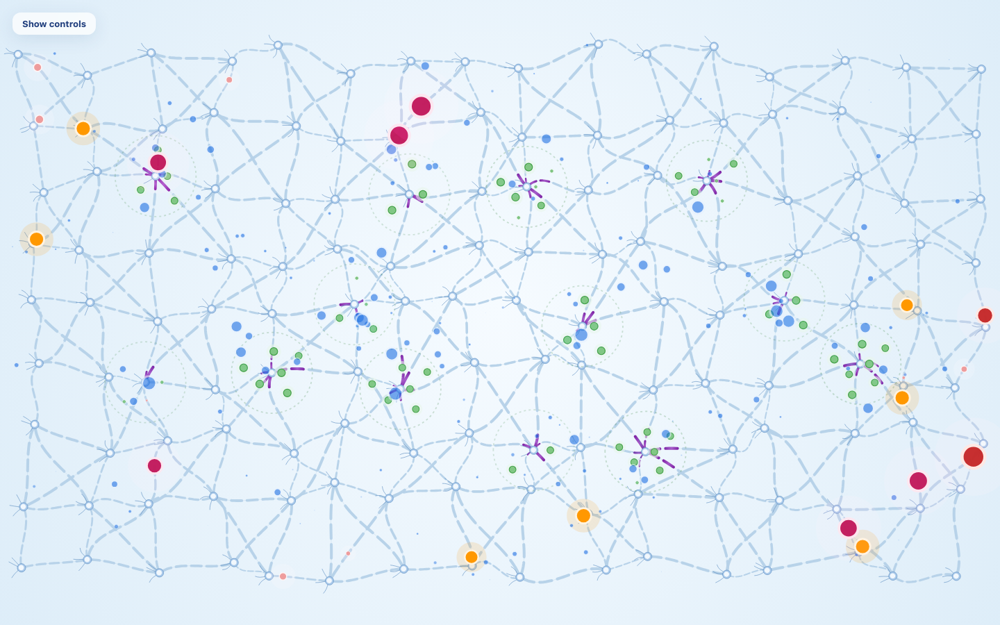
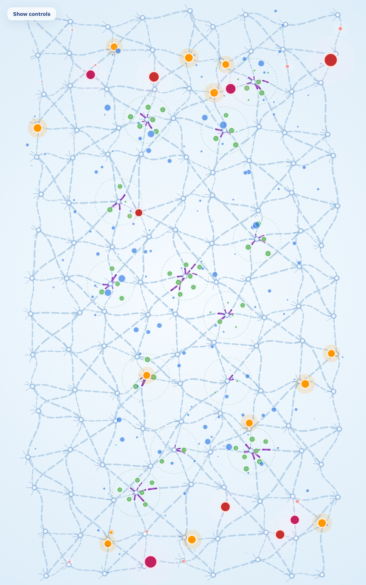
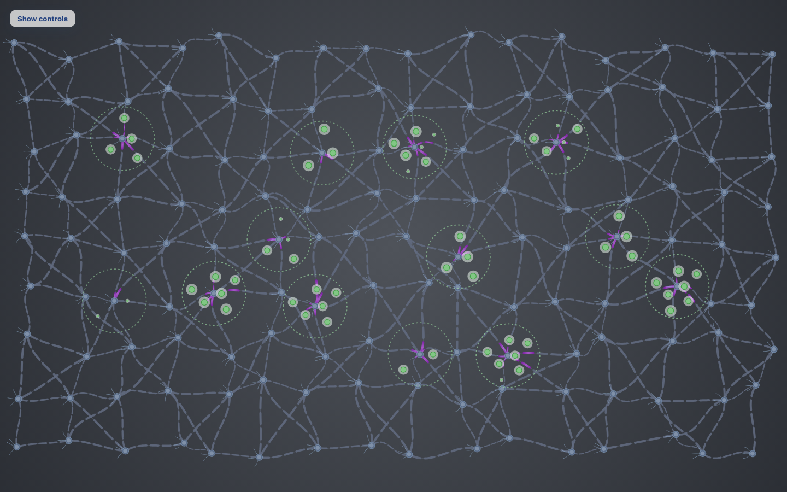

# Paper Life

**Schwann-cell crystallization.** On a 1440×900 window the brain is a 16×9 lattice: 383 axons, each five thin Schwann cells of equal length along that axon. A taller window picks a taller lattice. A resting cell is a very light blue, almost the background. During sleep, each thought that settles into a permanent home turns exactly one eligible cell purple (`#7b1fa2`, lighter at the center). Cells turn purple radially outward, clockwise around the hub. A lap paints the nearest cell of each spoke before any spoke gains its second cell. When every eligible axon of a neuron is fully crystallized, the domain grows and the next ring becomes eligible. Tossed thoughts and daytime housing color nothing. Saturation is purple cells divided by all cells (1,915 on 16×9), and the peak never falls, so age still moves only while sleep crystallizes. Somas and nuclei keep their normal colors. The underlying axon is only a thin connector. Where an older paragraph below still says thickness, read it as this Schwann-cell coverage.


Paper Life is one brain, drawn as a network, living from birth toward a saturation limit. Outside thoughts enter at the border, shrink as they travel, and sometimes find a temporary home. Internal thoughts answer from category centers. Sleep is automatic: kept homes fly to a permanent cluster, and only then does the brain turn one Schwann cell purple on an axon of that cluster. Age is that knowledge, not the clock.

Serve the `Paper-life` folder and open `index.html`. Paper.js 0.12.17 is loaded from the CDN, so a static server is required.

```
python3 -m http.server 8099 --bind 127.0.0.1
```

Then open `http://127.0.0.1:8099/`. A query string can seek, freeze, or expose diagnostics (see [URL parameters](#url-parameters-and-window__life)).

## The brain

`config.network.count` is 144 neurons. At startup the page picks the factor pair of 144 whose cols/rows is closest to the window's width/height. A 1440×900 window gets 16×9. A square window gets 12×12. A 900×1440 window gets 9×16. `?aspect=16x9` (or a width/height ratio) forces the pair for that load only. Resizing the window does not rebuild the lattice or restart the life; the same network is refit. If the window's aspect then disagrees with the lattice, the extra space is a mild letterbox of the background.

World space is that rectangle: one unit is one lattice step, so 16×9 is 16 units wide and 9 tall. The renderer maps it with one scale, centered. Horizontal and vertical steps are the same pixel length. The background still covers the whole window.

Each neuron is jittered by `mulberry32(23)` by about ±22–30% of that step, independently on x and y, and kept at least 0.55 units from every other neuron. A sample that would land closer is redrawn; the unjittered center is the fallback. Nothing sits closer than 0.18 units to the world edge. On the 16×9 lattice the axons then run from 0.60 to 1.93 units (mean 1.19, coefficient of variation 0.24). Each neuron grows three dendrites and has a large nucleus, about 0.64 of the soma radius. Neighbors are joined by cubic Bézier axons: horizontal lanes, alternating diagonals, and vertical links, walkable in either direction. The bend of each axon is a hash of its endpoints. A 16×9 lattice has 383 axons and 1,915 Schwann cells; 12×12 has 386 axons.

`config.categories.count` neurons are category centers. The count is 13. They are chosen by continuing the same seeded shuffle, at least two cells in from the border, and at least three world units apart. If that separation cannot place every center, it relaxes by half a unit until it can. On 16×9 and 9×16 this seed settles at 1.5; on 12×12 it holds at 2. The centers are not arranged in rows.

## Outside thoughts

Three kinds enter from any of the four borders and walk inward.

| Kind | Odds | Regular size | Lifetime (s) | Color |
| --- | --- | --- | --- | --- |
| Danger | 16% | 1.8 | 9–13 | `#c62828` |
| Attraction | 18% | 1.6 | 8–12 | `#c2185b` |
| Everyday | the rest, 66% | 0.62 | 1.5–2.8 | `#ef9a9a` |

Spawn rate is 11 per simulated second, multiplied by the age stage's acceptance. Lifetime is also scaled by risk affinity, from 0.75× late in life to 1× at birth.

An accepted thought is drawn at 3.4× its regular size and shrinks along a fixed curve:

```
scale = 0.15 + (3.4 − 0.15) × (1 − age/ttl) ^ 1.35
```

That is 3.4 at entry and 0.15 at expiry. Opacity eases down over the last 28% of the life. A fresh everyday thought is therefore about 2.11 visual units; a fresh danger thought is about 6.12.

Three endings:

1. **Border rejection.** A familiar danger or attraction can be refused at the border. Lifetime is 0.22–0.38 seconds and the bead collapses to zero. No home, no wave, no internal thoughts.
2. **Temporary home.** The traveler meets an internal thought near a neuron other than that internal thought's source, and lust allows it. The traveler is removed. An orange crystal appears at exactly 2× the kind's regular size.
3. **Insignificant fade.** The thought finishes its path, or its lifetime ends, without a home. It shrinks to the fade size and is gone.


## Temporary homes

Orange is `#ff9800` with core `#fff3e0`, drawn at exactly 2× the kind's regular size, whatever size the traveler had shrunk to. A small blue partner bead sits beside a temporary home.

The moment of housing brushes the background with one wave. This is a metaphor, not a measurement.

| Kind | Wave | Colors |
| --- | --- | --- |
| Attraction | Reward | gold into rose |
| Danger | Stress | crimson into violet |
| Everyday | none | |

The wave lasts 0.9–1.3 seconds, expands across most of the screen, and fades. Overlapping waves share one opacity cap. The pool holds 16 waves. Ordinary housing, rejection, meditation, travel, settlement, and rebalancing emit none.

## Internal thoughts

Internal thoughts are blue (`#1d6fe3`, and `#5c9cff` once the background has gone dark). They never cause further internal thoughts.

- **Accepted thought, once.** A thought that passes the border and is accepted for housing (its housing roll is under lust/100) fires one burst as it starts traveling: exactly 7 blue thoughts, from 7 distinct category centers chosen by a hash. It does not fire again while it travels, shrinks, or later finds a home. A border rejection fires nothing. At meditation (lust 0) nothing is accepted for housing, so nothing fires.
- **Temporary or wandering home, on a timer.** Each such home has its own 3–6 second interval, hashed from its identity, so homes do not pulse together. Each tick emits 1, 2, or 3 internal thoughts from that many distinct centers, any of the `config.categories.count` centers. The timer runs while the home is temporary and while it wanders during sleep. It stops for good when the thought settles, or when sleep tosses it.
- A burst is atomic. Seven free slots, or the acceptance burst is dropped whole. Up to three free slots, or that tick is dropped whole. Drops are counted in `droppedInternalBursts`. A normal first day and first night drop none.

Each blue thought independently draws a size class, mixed inside the burst, not copied from the trigger:

| Class | Visual size |
| --- | --- |
| Medium | 1.15 |
| Large | 2.1 |
| Extra large | 3.4 |

It then shrinks to nothing:

```
size = initialScale × (1 − age/ttl) ^ 1.2
```

Awake lifetime is 2.6–4.2 seconds, 35% longer asleep, and shorter as the brain ages. Blue thoughts leave their centers on hashed headings and bounce inside the grid. They are recycled at the end of that life.

A blue thought and a traveler crystallize only while they are still close enough for their current sizes. The meeting distance uses the average of the two visible sizes, divided by the 3.4 entry scale.

When no new thought is being accepted and nothing is temporary or wandering, no new internal thoughts are created. Whatever is already flying finishes, and the mind goes quiet.

The counter pool holds 610 slots. The first night on the 16×9 lattice drops no bursts. When more than 72 are on screen at once, their shared opacity is lowered. None are skipped.

## Lust for learning

The only control is a slider from Meditation (0) to Eager (100).

```
lustNatural = 100 × (1 − peakSaturation / 0.8)
```

clamped to 0–100. An empty brain rests at 100. As peak saturation approaches 80%, lust rests near 0. Natural lust moves only when peak saturation moves, and peak saturation moves only when sleep consolidates, so an awake bout holds lust still.

Dragging forces a value and holds it. On release it eases back toward natural with time constant 3.5 simulated seconds (`1 − e^(−dt/3.5)`). It counts as forced until it is within 0.5 of natural. `setLust` is the same nudge from code.

Housing chance equals lust/100.

- At 100, a meeting can crystallize, and every thought that passes the border fires the seven-center burst.
- At 0, meditation: thoughts still enter large, flow, shrink, and fade. No temporary home, no wave, no acceptance burst. A home that already exists keeps its 1–3 timer until it settles or is tossed.
- In between, the share of travelers accepted for housing, and therefore the share that fire the burst, equals lust/100.

## Age and knowledge

Saturation is the fraction of axon length covered by knowledge. Age is `100 × peakSaturation / 0.8`. Peak saturation never falls, so a night that concentrates wiring cannot make the brain younger.

Thickness deposited in sleep is scaled by growth. Age 0–100 is mapped onto 0–90 degrees:

```
growth = max(0.2, cos(age × 0.9°) − 0.0001)
```

Youth is near 1. The floor of 0.2 keeps late life from stalling. Life ends when peak saturation reaches 80% (within 0.001). The picture holds for 3 seconds, the veil fades in, and a new life begins.

Two filters ride the same progress, `peakSaturation / 0.8`. Filter strength is a smoothstep from 4% to 96% of that progress, and it scales how readily a familiar danger or attraction is refused at the border (chance from 0.15 to 0.55). Risk affinity is the complement and shortens lifetimes as it falls.

## Life stages

Sleep ratio, acceptance, and keep chance are interpolated between these anchors and clamped outside them. The stage name on the panel flips at the halfway point between anchors. The age labels on the age bar (Early childhood, Childhood, and so on) are a separate scale and are not these stages.

| Age | Stage | Sleep / awake | Acceptance | Keep |
| --- | --- | --- | --- | --- |
| 0 | Infant | 18 / 6 | 1.00 | 0.90 |
| 8 | Elementary | 12 / 12 | 0.70 | 0.72 |
| 16 | High school | 8 / 16 | 0.48 | 0.55 |
| 24 | Young adult | 6 / 18 | 0.34 | 0.42 |
| 48 | Adult | 6 / 18 | 0.30 | 0.36 |
| 70 and above | Older adult | 5 / 19 | 0.22 | 0.28 |

The sleep/awake column is reference only. It no longer sets night length or onset. Acceptance and keep chance still apply.

## Seeds, onset, and night length

**Seeds.** At birth each of the 13 hubs holds one permanent light-green thought at slot 0, at 1× size, of the hub's family kind (danger, attraction, or ordinary). Each seed paints exactly one Schwann cell through the normal clockwise sweep: the near cell of that hub's first clockwise spoke. So t=0 shows 13 crystallized thoughts and 13 purple cells, one per hub, and later housing continues the sweep after them. Seeds never emit internal thoughts.

**Counts.** Crystallized `C` is every settled (permanent) thought, seeds included. Unsettled `U` is every temporary or wandering thought. Tossed thoughts are in neither.

**Onset.** Sleep begins on the frame `U ≥ threshold(C)`, with

```
threshold(C) = max(5, round(5 × C / 13))
```

At C = 13 this is 5. It grows with permanent knowledge: about 8 at C≈21, 13 at C≈34, 21 at C≈55. There is no minimum awake time.

**Duration.** Night length is `sleepHours(U, C)`, evaluated at the U and C present when sleep starts. U sets the length through these anchors, with ln(hours) linear in ln(U) between them and flat outside:

| Unsettled U | Hours |
| --- | --- |
| ≤ 5 | 18 |
| 8 | 12 |
| 13 | 8 |
| ≥ 21 | 4 |

Crystallized thoughts only shorten the night. If `C > 13 × U / 5` (permanent knowledge ahead of the onset curve), hours are multiplied by `clamp(13 × U / (5 × C), 0.5, 1)`. Otherwise the multiplier is 1, so the night is never longer than the unsettled-only value. At the onset points (8, 21), (13, 34), and (21, 55) this gives 11.89, 7.95, and 3.97 hours.

Hours become simulated seconds at `sleep.secondsPerHour = 2`: 18 h is 36 s, 12 h is 24 s, 8 h is 16 s, 4 h is 8 s. Early in life the brain sleeps long after few unsettled thoughts; later it tolerates more and sleeps less.

## The automatic sleep cycle

There is no awake/sleep control. Need is U divided by the threshold. Sleep begins once need reaches 1. The background follows the phase. Each new target eases in with time constant 0.55 seconds, so the screen arrives in about 1.5–2 seconds.

| Phase | Center | Edge | Meaning |
| --- | --- | --- | --- |
| `awake` | `#f6fbff` | `#d8eaf7` | Light blue. Freshly awake. |
| `sleep-needed` | toward `#fff1f1` | toward `#f6d5d5` | Light red, in proportion to need. The blend starts at need 0.2. |
| `rem` | `#f3fbf4` | `#d9f0dc` | Very light green. First half of the night. |
| `deep` | `#4f535a` | `#24272d` | Dark gray. Second half. |
| `waking` | back toward light blue | | 1.8 seconds, then awake. |


Total sleep is `sleepHours(U, C) × 2` seconds. REM is the first half. Deep sleep lasts exactly as long as the REM just finished, within one frame (1/60 second).

At the start of REM every temporary thought, and every thought already in transit, is kept or tossed once, by a hash of its identity and the night, using the age's keep chance. Permanent thoughts are never tossed later.

- Tossed thoughts fade for 1.2 seconds. They do not travel, settle, turn a Schwann cell purple, or emit internal thoughts.
- Kept thoughts detach, stay orange at 2×, and fly at 3× their daytime speed, bouncing inside the brain. On arrival they turn light green (`#81c784`, edge `#43a047`) and ease to exactly 1× the kind's regular size over about a quarter of a second.

As the background darkens, axons, dendrites, somas, nuclei, rings, and internal thoughts ease toward a brighter night palette so they stay readable. Nothing in that palette is pure white. Awake and REM keep the day palette. Permanent thoughts stay light green in every phase.

If work is unfinished when deep sleep ends, the remaining kept thoughts are placed and the categories are balanced on that frame. Deep sleep is not extended.

## Knowledge growth

Purple Schwann cells are sleep-only. Daytime crossings do not color a cell or move saturation. A tossed thought colors none.

Each axon is exactly five Schwann cells, spaced by arc length so they look the same length, with a gap between them. Uncrystallized cells are a very light blue, a few shades darker than the awake background edge (`#d8eaf7`), so they stay faintly visible on light blue, light red, and very light green. In deep sleep they shift to a dim gray-blue on the dark gray. The connector line underneath is lighter still. A crystallized cell is `#7b1fa2` with a lighter center (`#a75bc9`) spread across the whole cell, so one cell never reads as two. Cells are thin, about 0.045 of a grid cell wide, and their round caps are inset so the gaps stay open. The soma and nucleus stay the normal palette colors. There is no thick axon overlay.

One permanent housing turns exactly one eligible cell purple. The order is a clockwise radial sweep measured on the jittered positions. Angles are in screen space, where y grows downward: 0 is 12 o'clock, straight up, and the angle increases clockwise (`atan2(dx, -dy)`).

Ring 1 is the spokes leaving the hub, sorted by the angle from the hub to the neighbor. The first housing paints the cell nearest the hub on the first spoke, the next housing paints that same cell on the next spoke clockwise, and so on around the ring. Only after every spoke has that cell does the sweep start the next cell farther out. When all five cells of every spoke are purple, the hub is fully crystallized and its domain grows.

The neurons that join form the next ring, ordered clockwise around the hub from 12 o'clock. Each contributes its outward axons, one axon per neuron per pass, so the sweep goes around the ring rather than finishing one neuron first. An axon that leads back toward the hub, or that ends on another category's neuron, is skipped. Further rings follow the same way. Domains do not share a neuron.

Saturation is `purpleSchwannCells / totalSchwannCells`. With five equal compartments that count is the length-weighted coverage. Peak saturation never falls. Age is `100 × peakSaturation / 0.8`.

There are `config.categories.count` categories, currently 13, split across the three families as evenly as possible. Earlier families take the remainder, so danger has 5, attraction 4, and everyday 4. Each family cycles this weight pattern, and stops early when the family is shorter than the pattern:

```
0.7, 1.5, 1.0, 1.8, 1.2, 0.6, 1.4
```

That yields 13 weights, not a fixed list of 21. Categories 0–4 are danger, 5–8 attraction, 9–12 everyday. Family is semantic. Position is the scatter above. The largest category holds three times the smallest.

Each domain starts as a small ring around its anchor, `0.72 + 0.5 × (weight / 1.8)`, and never wider than 0.42 times the gap to the nearest other anchor, so the rings do not cover a neighbor at birth. The ring grows when a neuron's eligible axons are all five-purple. Neurons outside every domain are not painted.







Classification prefers the matching family, then the category furthest below its weighted share. During deep sleep, a thought moves from the category furthest over its target to the one furthest under it, about every 0.6 seconds, while the surplus and deficit are at least one thought. The clusters are not meant to end up the same size.

## Visual legend

| Mark | Meaning |
| --- | --- |
| Large red, magenta, or pink bead | A thought that just entered, at 3.4×. It shrinks as it travels. |
| Tiny fading bead | A thought becoming insignificant, toward 0.15×. |
| Bead that collapses in under 0.4 s | Border rejection. No home, no wave, no internal burst. |
| Large orange bead | Temporary home, or traveling to a cluster, at 2×. |
| Light green bead, regular size | Permanent home, at 1×. |
| Blue bead, three sizes | Internal thought. Medium 1.15, large 2.1, extra large 3.4, then shrinking to nothing. |
| Warm gold-rose ring | Reward metaphor when attraction finds a temporary home. |
| Crimson-violet ring | Stress metaphor when danger finds a temporary home. |
| Green dashed ring | A category domain. |
| Five thin, very light capsules along each axon | Schwann cells. The thin line under them is only a connector. |
| Purple capsule, lighter in the center | One permanent housing. `#7b1fa2`. Fills from the hub outward. |
| Light blue, light red, very light green, dark gray | Awake, sleep-needed, REM, deep sleep. |

## Controls

The control box starts hidden. **Show controls** sits at the top left; **Hide** is inside the panel. The choice is stored in `paperLife.hudHidden` (`1` hidden, `0` shown). A missing key means hidden. The life keeps running while the box is closed, and the panel refreshes when it is opened. The transition is about 200 milliseconds.

Inside the box: knowledge saturation, age and stage, sleep need, cluster counts, the wave note, a color legend, and the lust slider.

The panel and the show button are translucent white with dark blue text, so they stay readable on light blue, light green, and dark gray.

## URL parameters and `window.__life`

| Parameter | Effect |
| --- | --- |
| `aspect=16x9` | Force that lattice for this load, when the product is `network.count`. A bare ratio such as `1.6` chooses the closest pair. Resize does not apply it again. |
| `t=N` | Start N simulated seconds into a life. Uses `seek`, which resets and runs forward. |
| `still=1` | Draw that frame and do not animate. |
| `lust=N` | Force lust to N, then let it ease back. If `t` is also set, the run resumes instead of seeking, so the forced lust is not reset. |
| `hud=1` | Show the panel for this load only. |
| `hud=0` | Hide the panel for this load only. |
| `diag=1` | Write `stats()` JSON into `#diag`. |
| `bench=1` | Advance 12 seconds, time 48 draw frames, write average, p95, and Paper item count into `#diag`. |

`prefers-reduced-motion` freezes the animation and, if `t` is absent, opens the life at 55 seconds.

`window.__life`:

| Method | Effect |
| --- | --- |
| `seek(seconds)` | Reset and run forward, then draw. |
| `resume(seconds)` | Run forward from now, then draw. |
| `freeze(on)` | Stop or resume the animation clock. |
| `setLust(0–100)` | Force lust, then let it ease back. |
| `holdLust(value)` / `releaseLust()` | What the slider does while the pointer is down, and when it lifts. |
| `time()` | Simulated time. |
| `stats()` | Saturation, age, stage, lust, housing chance, sleep lengths, waves, bursts, cluster sizes, domains. |

A backgrounded tab cannot fast-forward the life. Each frame advances at most 0.05 simulated seconds.

Stats worth knowing: `fastRejectedThoughts`, `insignificantFades`, `temporarilyHoused`, `rewardWaves`, `stressWaves`, `internalBursts`, `acceptanceBursts`, `homeBursts`, `internalParticles`, `droppedInternalBursts`, `peakActiveCounters`, `latestBurst` (its trigger, source categories, and size classes), `lust`, `lustNatural`, `housingChance`, `ageStage`, `acceptance`, `keepChance`, `awakeDuration`, `sleepTarget`, `remDuration`, `deepDuration`, `keptThisSleep`, `tossedThisSleep`, `crystallized`, `unsettled`, `sleepThreshold`, `sleepHours`, `sleepSeconds`, `onsetUnsettled`, `onsetCrystallized`.

## Architecture

| File | Owns |
| --- | --- |
| `index.html` | Canvas, hidden-by-default panel, lust slider, script order. |
| `styles.css` | Panel, show button, sleep-need bar, slider, veil. |
| `js/config.js` | Grid, pools, stages, lust, waves, colors, sleep, kinds. |
| `js/util.js` | `clamp`, `lerp`, `smoothstep`, deterministic `hash`, `mulberry32`. |
| `js/network.js` | Neurons, Bézier axons, scattered anchors. No behavior. |
| `js/simulation.js` | The life. No Paper.js. |
| `js/renderer.js` | Pixels only. Reads the snapshot and the pools. |
| `js/hud.js` | The panel, including show/hide and the lust slider. |
| `js/main.js` | Setup, URL parameters, frame cap, bench hook, `window.__life`. |

`main.js` builds the network, the simulation, and the renderer. Each frame the simulation advances, the snapshot is drawn, and the panel updates. The renderer never writes model state.

## Performance

Pools are fixed: 144 thoughts, 610 internal thoughts, 377 crystals, 16 waves. Paper paths are created once and hidden with `visible = false`. Schwann cells are created once too: exactly five paths per axon, 1,915 for the 383 axons of a 16×9 lattice. A frame only recolors a cell when it turns purple or the sleep contrast changes. Saturation is recomputed only after a cell changes, which is during sleep. Settled counts are incremental. The internal-thought free list is a preallocated stack, and a burst reuses one center-index array, so a burst does not allocate. The frame catch-up is capped at 0.05 seconds.

There is no spatial hash. A meeting test walks active internal thoughts against active travelers. That is cheap while the pools stay at this size.

Node, `advance(1/60)` on the 16×9 lattice: t=0 has 13 crystallized seeds and 13 purple cells, one per hub. Sleep-needed starts at 2.0 s; the first sleep starts at 3.68 s with U = 5 and C = 13, so 18 hours: REM 18.00 s, deep 18.00 s, waking at 39.68 s. After that night: 23 purple cells (13 seeds plus 10 settles), 2 tossed.

Headless Chrome, `?still=1&hud=0`: `t=72` at 1440×900 is awake on 16×9, `t=72` at 900×1440 is awake on 9×16, and `t=55` at 1440×900 is deep. These three screenshots predate the seeds and the new sleep timing, so the same `t` now lands in a different phase. A frame recolors a cell only when it turns purple or the sleep contrast changes. A `?bench=1` frame-time dump was not returned by headless Chrome in this pass, so average and p95 frame time are not reported. A frame recolors a cell only when it turns purple or the sleep contrast changes.

## Tuning

| Constant | Value | What it controls |
| --- | --- | --- |
| `network.count` | 144 | Neurons. The lattice is the factor pair closest to the window aspect. |
| `pools.thoughts`, `counters`, `crystals` | 144, 610, 377 | Fixed pools. |
| `spawnRate` | 11 | Travelers per second before acceptance. |
| `entryScale`, `fadeScale`, `shrinkPower` | 3.4, 0.15, 1.35 | Traveler size from entry to fade. |
| `crystalScale` | 2 | Orange temporary and wandering size. Settled is 1×. |
| `internal.acceptCount`, `homeMax` | 7, 3 | Centers per acceptance burst, and the maximum per home tick. |
| `internal.intervalMin`, `intervalMax` | 3, 6 | Seconds between home ticks. |
| `internal.sizes` | 1.15, 2.1, 3.4 | Medium, large, extra large. |
| `internal.ttlMin`, `ttlMax`, `sleepTtl` | 2.6, 4.2, 1.35 | Internal lifetime; sleep multiplies by 1.35. |
| `internal.shrinkPower` | 1.2 | How internal size falls to zero. |
| `lust.tau`, `forcedBand` | 3.5, 0.5 | Easing back to natural, and when a nudge still counts as forced. |
| `life.saturationLimit`, `growthFloor`, `hold` | 0.8, 0.2, 3 | End of life, late-life growth floor, seconds the finished picture is held. |
| `sleep.secondsPerHour` | 2 | Simulated seconds per hour of `sleepHours`. Onset is `max(5, round(5C/13))` unsettled thoughts. |
| `sleep.travelMultiplier` | 3 | Sleep flight versus daytime speed. |
| `sleep.deposit`, `consolidationBonus` | 0.72, 0.03 | Latent weight a home still carries. Settling paints one Schwann cell, not this amount. |
| `schwannPerAxon` | 5 | Schwann cells drawn on every axon. |
| `categories.count` | 13 | How many scattered category centers. Families and weights are derived from this. |
| `categories.weightPattern` | 0.7 … 1.4 | Uneven category sizes, cycled inside each family. |
| `waves.pool`, `ttlMin`, `ttlMax` | 16, 0.9, 1.3 | Hormone-metaphor waves. |

## Known limitations

A full life to 80% saturation was not timed. After the first night on 16×9 the brain has 74 purple Schwann cells out of 1,915. A night paints cells one housing at a time; it does not color the whole network.

Reward and stress waves are visual metaphors for a pulse of reward or stress. They are not a hormone assay, and they are not two named chemicals.

The meeting test is a direct scan, not a spatial hash. It is fine at the current pool sizes and would need another look if those pools grew by an order of magnitude.

Seeking with `t=` runs in 0.1 second slices, while the live page steps at about 1/60 second, so a seek and a watched minute can differ by a meeting or two. The hash stream itself does not use `Math.random`.
