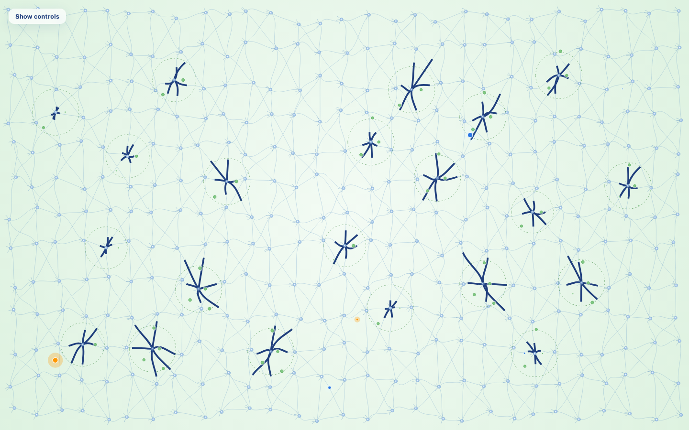
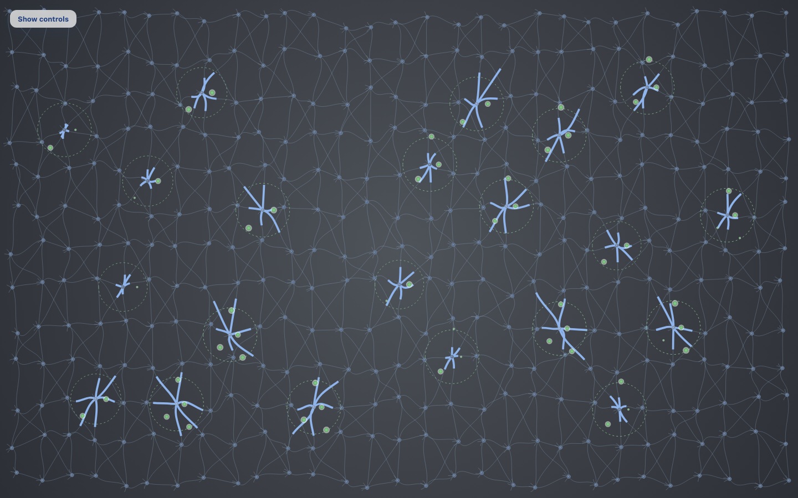

# Paper Life

A Paper.js animation of one life, from age 0 to 100, on a brain of 377 neurons. Age is not a clock. It is how much of the wiring has become knowledge. Sleep is not a switch. It arrives when too many thoughts are parked in temporary homes, and the length of that night is a function of how long the brain was awake and how old it is.

The model runs in grid cells. The renderer only turns those cells into pixels, so two windows of different sizes live the same life.

## Concept

Outside thoughts enter large. While they travel they shrink. Each one ends in one of three ways:

1. **Fast rejection.** A familiar danger or attraction is recognized at the border and collapses in a fraction of a second. Nothing is left: no temporary home, no hormone wave, no thickness.
2. **Temporary home.** The thought meets an internal counter-thought near a center and stops. The traveling bead disappears. An orange crystal appears at exactly twice the kind's regular size, however small the traveler had become.
3. **Insignificance.** If it never finds a home, it keeps shrinking, fades, and is recycled. No residue.

A temporary home is not yet knowledge. Knowledge is thickness, and thickness is laid down only during sleep, around permanent clusters. Attraction and danger, on the moment they take a temporary home, also brush the background with a wave. That wave is a visual metaphor for a reward response or a stress response, not a measured hormone.

## The network

377 neurons, the first Fibonacci number above 300, on a 29 by 13 grid. Neighbors are joined by 1,048 cubic Bézier axons, walkable in either direction. Twenty-one anchors are existing neurons, scattered by the same seeded shuffle that builds the brain (`mulberry32(23)`), at least two cells in from the border and about three cells apart. They are not arranged in rows. Categories 0–6 are still the danger family, 7–13 attraction, and 14–20 everyday thoughts, but a family is not a region of the screen.

## Thoughts from outside

Three kinds enter from any border. Kind sizes stay in proportion at every scale.

| Kind | Share | Color | Regular size | Lifetime |
| --- | --- | --- | --- | --- |
| Danger | 16% | `#c62828` | 1.8 | long |
| Attraction | 18% | `#c2185b` | 1.6 | long |
| Everyday | the rest | `#ef9a9a` | 0.62 | short |

An accepted thought is drawn at `entryScale` (2.2) times its regular size. Scale then follows age divided by lifetime:

```
scale = 0.15 + (2.2 − 0.15) × (1 − age/ttl) ^ 1.35
```

That is 2.2 at entry, about 0.95 at midlife, and 0.15 just before it vanishes. Opacity eases down over the last part of the life. The curve is computed from age and lifetime each frame. The bead is not grown by accumulating a delta, so it cannot drift.

How often thoughts are even allowed in depends on age. The spawn rate is multiplied by an acceptance factor that falls from 1.00 in infancy to 0.22 in later life. A border filter can still refuse a familiar danger or attraction after that. Those refusals use a lifetime of 0.22–0.38 seconds and a scale that collapses to zero. They do not emit internal thoughts.

## Temporary homes and hormone waves

A red thought and a blue counter-thought that meet near a center other than the counter's source can crystallize, if lust allows it. The traveler is removed. The crystal is orange (`#ff9800`, core `#fff3e0`) at exactly 2× the kind's regular size, with a small blue partner bead beside it.

Exactly one wave is emitted per successful temporary home:

| Thought | Wave | Colors | HUD |
| --- | --- | --- | --- |
| Attraction | `reward` | warm gold into rose | Reward response |
| Danger | `stress` | crimson into violet | Stress response |
| Everyday | none | | |

The wave starts at the home and expands across most of the screen for 0.9–1.3 simulated seconds, then fades. It is translucent, so the sleep colors underneath stay readable. Overlapping waves share one opacity cap. Ordinary housing, border rejection, meditation, sleep travel, permanent settlement, and rebalancing emit no wave. The stress wave stands for an adrenaline/cortisol-like response, not a single negative hormone. The reward wave stands for a dopamine-like pulse. Neither is a biological measurement.

Waves live in a fixed pool of 16 and are stored in grid space (`x`, `y`, `type`, `kind`, `age`, `ttl`), so a seek to the same time reproduces them.

## Internal thoughts and a calm mind

Internal thoughts are blue (`#1d6fe3`). They are caused, not sprayed, and they are born the same size as the thought that caused them:

- A new external thought that is eligible to be thought about gets one initial burst of one to three counters as it enters. Each counter copies that traveler's current visible size (kind size times its shrinking scale). A fresh 2.2× entrant makes an equally large blue thought. An older, already-shrunken entrant makes a smaller one. A fast-rejected thought does not. A thought refused by meditation does not.
- Every temporary home and every thought still traveling to a cluster has its own timer, once every 2.5–5.5 seconds (a little sooner during sleep). The counter copies that orange thought's size, which is 2× its kind, even when the counter is launched from a permanent cluster instead of the orange thought's own site. The timer stops forever once the thought settles.

The copied size is stored as `initialScale` and does not change. From there the blue thought shrinks to nothing:

```
size = initialScale × (1 − age/ttl) ^ 1.2
```

Opacity fades over the last part of that life. At the end the thought is recycled and leaves no trace.

A blue thought and a traveling thought crystallize only while they are still close enough for their current sizes. The meeting distance is the average of the two visible sizes, divided by the 2.2 entry scale, so a freshly emitted pair reaches as far as before, and a shrunken internal thought has to pass closer. That keeps early housing, and the automatic need for sleep, about where they were.

When nothing is unsettled and no external thought is eligible, no new internal thoughts are created. Whatever is already in flight finishes, and the mind goes quiet.

## Lust for learning

The status panel has one slider, **Lust for learning**, from Meditation (0) to Eager (100).

The only resting value is the natural equilibrium:

```
lustNatural = 100 × (1 − peakSaturation / 0.8)
```

clamped to 0–100. An empty brain rests near 100. As saturation approaches the 80% end of life, lust rests near 0. Natural lust moves only when saturation moves, and saturation moves only when sleep consolidates thickness, so an awake bout holds lust still.

Dragging the slider forces a value, including exactly 0 or 100. While the pointer is down, the slider follows the finger. On release it eases back toward the moving natural value with time constant `lust.tau` of 3.5 simulated seconds (`1 − e^(−dt/3.5)`), so most of a large gap closes in about 8–12 seconds. It is no longer forced once it is within 0.5 of natural. `setLust` is the same nudge from code. Forcing lust does not change saturation.

Housing chance equals lust/100.

- At 100, a meeting can crystallize, which is as willing as the brain gets. Age acceptance and the border filter still apply.
- At 0, meditation: thoughts still enter large, flow, shrink, and fade, but housing chance is 0. No temporary home, no hormone wave, no new internal thought. Existing unsettled thoughts may finish their own cycles.
- In between, both housing and the initial internal response scale with lust.

## Age, growth, and the end

Saturation is the fraction of axon length covered by knowledge. Age is `100 × peakSaturation / 0.8`. Peak saturation never falls, so a night that concentrates wiring cannot make the brain younger.

Thickness deposited in sleep is scaled by growth:

```
growth = max(0.2, cos(age × 0.9°) − 0.0001)
```

Youth is near 1. The floor of 0.2 keeps late life from stalling forever. Life ends when peak saturation reaches 80% (within 0.001). The picture holds for 3 seconds, the veil fades in, and a new life begins.

Because thickness is sleep-only, a life that sleeps reaches 80% much more slowly than an always-awake sketch used to. A few nights leave the brain still in childhood.

## Life stages

The stage row is read from simulation age, linearly interpolated between the anchors and clamped outside them. Three effects move together: how many outside thoughts are accepted, how much sleep an awake bout earns, and how many temporary thoughts are kept for a permanent home.

| Age | Stage | Sleep / awake | Acceptance | Keep | Tossed |
| --- | --- | --- | --- | --- | --- |
| 0 | Infant | 18 / 6 | 1.00 | 0.90 | 10% |
| 8 | Elementary | 12 / 12 | 0.70 | 0.72 | 28% |
| 16 | High school | 8 / 16 | 0.48 | 0.55 | 45% |
| 24 | Young adult | 6 / 18 | 0.34 | 0.42 | 58% |
| 48 | Adult | 6 / 18 | 0.30 | 0.36 | 64% |
| 70 and above | Older adult | 5 / 19 | 0.22 | 0.28 | 72% |

The temporary-home count that forces sleep is the base threshold (0.38 × 377 ≈ 143) times a stage factor: about 0.45 in infancy, 1 from 24 to 48, and about 1.15 after 48. Infants therefore sleep after fewer temporary homes. Older brains tolerate slightly more, so their awake bouts run longer, and the short sleep ratio then makes the night itself short.

## Sleep

There is no awake/sleep control. Need is temporary homes divided by the age-scaled threshold. The background follows the night.

| Phase | Center | Edge | Meaning |
| --- | --- | --- | --- |
| `awake` | `#f6fbff` | `#d8eaf7` | Light blue. Freshly awake. |
| `sleep-needed` | toward `#fff1f1` | toward `#f6d5d5` | Light red, in proportion to need. |
| `rem` | `#f3fbf4` | `#d9f0dc` | Very light green, far paler than the settled beads. First half of the night. |
| `deep` | `#4f535a` | `#24272d` | Dark gray. Second half. |
| `waking` | back toward light blue | | About 1.8 seconds, then awake. |

The cycle reads light blue, light red, very light green REM, dark gray deep sleep, light blue. Every change of background eases over about 1.5–2 seconds. As the screen darkens into deep sleep the foreground eases to a brighter night palette (`colors.night`): pale-blue axons and dendrites, light-blue knowledge (`#8fb4ec`), brighter somas and nuclei, brighter counter blue (`#5c9cff`), light-green domain rings (`#9ad7a0`), and a stronger stress wave. None of them are pure white. Awake and REM keep the day palette. Permanent thoughts stay light green (`#81c784`, edge `#43a047`) in every phase.





On sleep onset the brain records the awake bout in simulated time, not wall-clock time. Total sleep is that duration times sleep/awake at the age when sleep begins. REM is the first half and deep sleep is the second half, so deep equals the adjoining REM within one frame (1/60 second). A short infant afternoon is followed by a night about three times as long. An older afternoon is followed by a much shorter night.

At the start of REM each temporary thought, and each thought already in transit, is kept or tossed once, by a stable hash of its identity and the night, using the age's keep chance. Permanent thoughts are never tossed later.

- Tossed thoughts fade during REM. They do not travel, settle, or transfer thickness.
- Kept thoughts detach, stay orange at 2×, and fly at 3× their daytime speed, bouncing inside the brain. On arrival they turn light green (`#81c784`, edge `#43a047`) and shrink to exactly 1× the kind's regular size. The scale eases over about a quarter of a second. Thickness moves with them: the carried daytime amount, a small drain from the temporary site, and a consolidation bonus, planted inside that category's domain.

If work is unfinished when deep sleep ends, the remaining kept thoughts are placed and the categories are balanced on that frame. Deep sleep is not extended.

## Twenty-one uneven categories

The same seven weights repeat down each family:

```
0.7, 1.5, 1.0, 1.8, 1.2, 0.6, 1.4
```

The largest holds about three times the smallest. Classification prefers the matching family, then the category furthest below its weighted share. During deep sleep, thoughts move from the category furthest over its target to the one furthest under it. The clusters are not meant to end up the same size.

## Domains

Each category starts as a small circumference around its scattered anchor, small enough that the ring does not already cover a neighboring center. Larger weights start a little wider. During sleep, thickness is fed to the least-thick neuron inside the domain. When a neuron becomes fully thick, the circumference grows to contain it and adjoining neurons that are nearer to this anchor than to any other begin to thicken on later sleep steps. Domains do not share a neuron. Neurons outside every domain are not the target of that deposit. All of this waits for sleep. Daytime crossings do not thicken axons, plant seeds, or move saturation.

## Visual legend

| Mark | Meaning |
| --- | --- |
| Large red, magenta, or pink bead | A thought that just entered. It shrinks as it travels. |
| Tiny fading bead | A thought becoming insignificant. |
| Bead that collapses in under 0.4 s | Border rejection. No home, no wave. |
| Large orange bead | Temporary home, or traveling to a cluster, at 2×. |
| Light green bead, regular size | Permanent home, at 1×. |
| Warm gold-rose ring | Reward response. A metaphor for a dopamine-like pulse when attraction finds a temporary home. |
| Crimson-violet ring | Stress response. A metaphor for an adrenaline/cortisol-like pulse when danger finds a temporary home. Not one hormone. |
| Blue bead, large or small | Internal counter-thought. Born at the trigger's size, then shrinking to nothing. |
| Green dashed ring | A category domain. |
| Dark blue axon | Knowledge. Only grows in sleep. |
| Light blue, light red, very light green, dark gray background | Awake, sleep-needed, REM, deep sleep. |

## Controls, URL, and `window.__life`

The control box starts hidden. A **Show controls** button at the top left opens it; **Hide** closes it again. That choice is remembered in `paperLife.hudHidden`. The life keeps running while the box is closed, and the panel refreshes as soon as it is opened. Inside the box, the only setting is the lust slider.

| Parameter | Effect |
| --- | --- |
| `t=N` | Seek N simulated seconds into a life. |
| `still=1` | Draw that frame and do not animate. |
| `lust=N` | Start with lust forced to N (0–100). It then slides home. With `t`, the seek runs at that forced value. |
| `hud=1` | Show the control box for this load. Overrides the saved choice. |
| `hud=0` | Hide the control box for this load. Overrides the saved choice. |
| `diag=1` | Write `stats()` JSON into `<pre id="diag">`. |
| `bench=1` | Time 48 frames on a busy scene. Reports average ms, p95 ms, and the Paper item count. |

`sleep`, `nap`, and `learn` are not parameters.

| Method | Effect |
| --- | --- |
| `seek(seconds)` | Reset and run forward. |
| `resume(seconds)` | Run forward from now. |
| `freeze(on)` | Stop or resume the animation clock. |
| `setLust(0–100)` | Force lust, then let it ease back. |
| `holdLust(value)` / `releaseLust()` | What the slider does while the pointer is down, and when it lifts. |
| `time()` | Simulated time. |
| `stats()` | Saturation, age, stage, lust, housing chance, sleep lengths, waves, fast rejections, insignificant fades, temporary homes, cluster sizes, domains. |

A backgrounded tab cannot fast-forward the life. Each frame advances at most 0.05 simulated seconds.

Stats worth knowing: `fastRejectedThoughts`, `insignificantFades`, `temporarilyHoused` (the same count as crystallizations), `rewardWaves`, `stressWaves`, `activeWaves`, `lust`, `lustNatural`, `lustForced`, `housingChance`, `ageStage`, `sleepAwakeRatio`, `acceptance`, `keepChance`, `awakeDuration`, `sleepTarget`, `remDuration`, `deepDuration`, `keptThisSleep`, `tossedThisSleep`.

## Files

| File | Owns |
| --- | --- |
| `index.html` | Canvas, status panel, lust slider, script order. |
| `styles.css` | Panel, sleep-need bar, slider, veil. |
| `js/config.js` | Grid, pools, stages, lust, waves, colors, sleep, kinds. |
| `js/util.js` | `clamp`, `lerp`, `smoothstep`, deterministic `hash`. |
| `js/network.js` | Neurons, Bézier axons, anchors. No behavior. |
| `js/simulation.js` | The life. No Paper.js. |
| `js/renderer.js` | Pixels only. Reads the snapshot and the pools. |
| `js/hud.js` | The panel. |
| `js/main.js` | Setup, URL parameters, frame cap, bench hook. |

## Performance

The hot cost was not drawing. It was, during sleep, every settled crystal scanning every crystal to count its cluster, 60 times a second. That scan is now a counter updated when a thought settles, leaves, or is moved. Saturation and neuron strength are recomputed only after an axon actually changes, which is during sleep; an awake bout does not walk all 1,048 edges. Paper items are pooled (thoughts, counters, crystals, waves) and hidden with `visible = false`. Thick axons are restyled only when their coverage changes. The frame catch-up is capped.

Measured on this machine, same life, Node, direct script load:

| Run | ms per simulated second |
| --- | --- |
| Before those two changes, 120 s | 7.93 |
| After, 120 s | 4.78 |
| After, 300 s | 3.59 |

The checkpoints at 30, 60, and 120 seconds match exactly across that change (saturation, crystallizations, settled count, strength, phase). Headless Chrome, 48 frames after 12 simulated seconds, at 1440×900: average 0.285 ms, p95 0.6 ms, 5,904 Paper items. That count is fixed: one path per axon, per neuron part, per pooled thought, counter, crystal, and wave.

An earlier profile of a previous build that accepted thoughts at a flat rate, before age acceptance, cost about 18 ms per simulated second over 300 seconds. That number is not comparable one-to-one, because the current life accepts fewer thoughts as it ages and therefore does less work. The 7.93 to 4.78 comparison is the one that holds the behavior fixed.

## Tuning

| Constant | Value | Role |
| --- | --- | --- |
| `entryScale`, `fadeScale`, `shrinkPower` | 2.2, 0.15, 1.35 | Traveler size from entry to fade. |
| `rejectTtlMin`, `rejectTtlMax` | 0.22, 0.38 | Fast rejection collapse. |
| `crystalScale` | 2 | Temporary and traveling homes. Permanent homes draw at 1×. |
| `spawnRate` | 11 / s | Before age acceptance. |
| `lust.tau` | 3.5 s | Return from a forced lust. |
| `life.saturationLimit` | 0.8 | End of life. |
| `life.growthFloor` | 0.2 | Late-life learning floor. |
| `sleep.needThreshold` | 0.38 | Base share of the pool that forces sleep, then scaled by stage. |
| `sleep.travelMultiplier` | 3 | Sleep flight versus daytime speed. |
| `sleep.deposit` | 0.72 | Thickness carried into the permanent domain. Everyday thoughts carry 0.45 of this. |
| `waves.pool` | 16 | Reward and stress waves. |
| `waves.ttlMin`, `ttlMax` | 0.9, 1.3 | Wave lifetime. |
| Category weights | 0.7 … 1.4 | Repeated for each of the three families. |

## Known limitations

A full life to 80% saturation takes a long time, because axons thicken only while the brain sleeps and each night only consolidates what the day managed to house. Two or three nights leave the brain near the end of childhood, not at the end of life. Domains expand only after a neuron is actually full, so early nights thicken the core of a category more than they grow its circumference. The hormone waves are metaphors. The lust equilibrium is a function of saturation, not of mood, time of day, or anything measured in a person.
