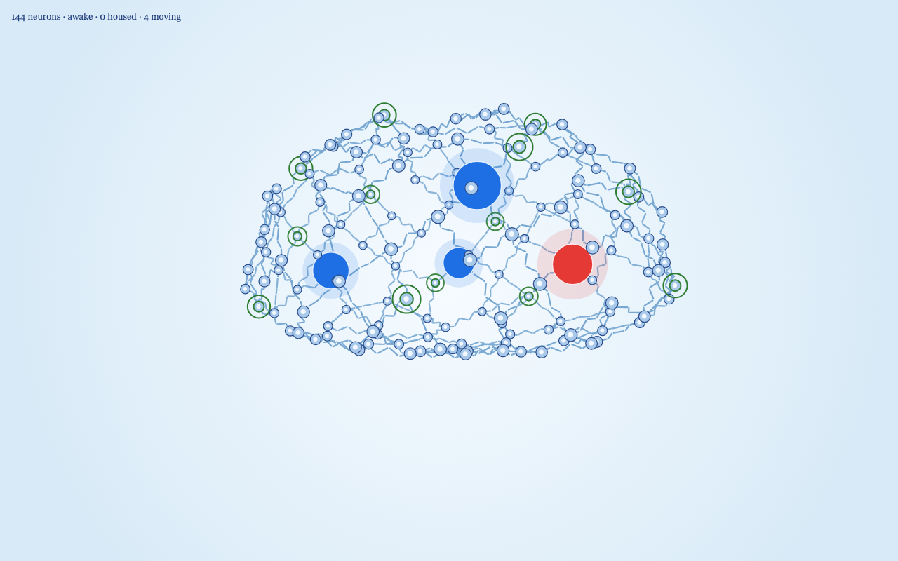
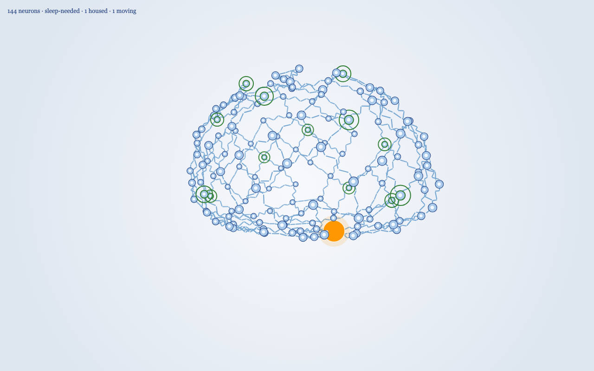
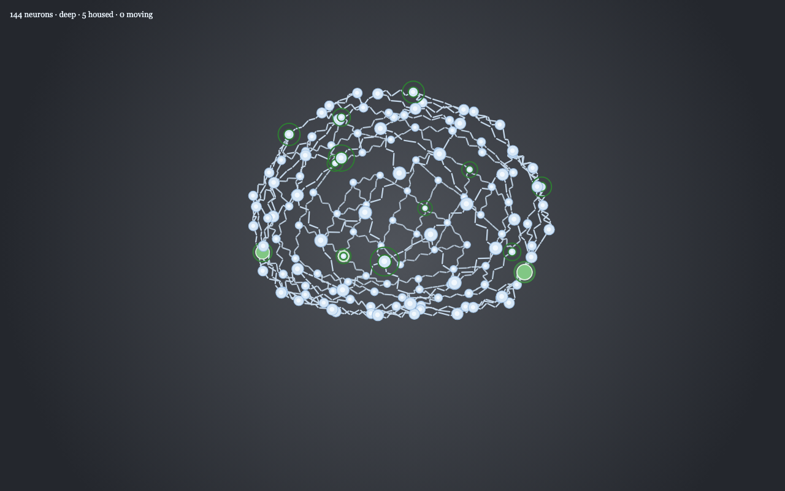

# Brain 3D, v1

A Paper.js drawing of a stylized brain skeleton. Paper.js only draws in 2D, so each neuron is a 3D point. Every frame, the points are rotated around the vertical axis and projected onto the canvas with perspective. Nearer neurons are larger and are drawn on top.


The first stage builds the skeleton:

- 144 neurons form a brain-like surface with two upper hemispheres, a shallow sagittal groove, a fuller frontal region, temporal bulges, a tapered rear, and a flattened underside. Change `network.count` in `js/config.js`. The layout is seeded, so the same count always gives the same shape.
- Each neuron connects to its three nearest neighbors. With 144 neurons that gives 245 axons in one connected network.
- Every axon is drawn as five pronounced, rounded Schwann-cell segments with small gaps: 1,225 visible cells at the default settings. The cells step sideways in a small seeded zigzag instead of sitting on a straight line. The kink is in the skeleton, so it turns with the brain.
- Thirteen thought-domain centers are scattered across the surface with the 2D rule: the same seeded shuffle, then the widest separation that still fits all thirteen. They split into families of 5, 4, and 4, with the repeating weights 0.7, 1.5, 1.0, 1.8, 1.2, 0.6, and 1.4. Each center is marked by a green ring. Every other neuron belongs to the nearest center.
- The skeleton turns at 6 degrees per second (`spin.degreesPerSecond`), one full turn per minute.
- Colors match the awake 2D brain: a light blue radial background, pale blue somas with a dark blue edge, small light nuclei at 0.42 of the soma radius, and blue Schwann cells.

## External and internal thoughts



One deterministic cohort runs at a time:

1. A large red external sensation approaches a seeded random surface neuron from outside the brain.
2. It follows a random, non-backtracking path along the visible zigzag axons and continuously shrinks.
3. Three distinct knowledge centers are selected. Each emits one blue internal thought that starts at 80–105% of the external sensation's current size. Each internal thought then shrinks at its own seeded rate: a lifetime of 4.5–12 seconds and a shrink curve between gentle and steep. It either fades to nothing or meets the shrinking external sensation.
4. Internal routes aim toward different future portions of the external route, with seeded timing variation. Encounters are possible without changing the external sensation's random path.
5. Collision is tested in 3D model space, not in the 2D projection. When a pair overlaps, both are consumed and the nearest neuron becomes a temporary home.
6. The temporary home stops, turns orange, and grows to twice the regular external-thought radius. Unused internal thoughts finish fading before the next cohort starts.



## Sleep cycle

The night uses the 2D duration rule. Five unsettled homes start an 18-hour night; more unsettled homes shorten it along the 8-hour, 13-hour, and 4-hour anchors, and crystallized homes can only shorten it further. One simulated second represents two hours.

- Awake is light blue. As temporary homes approach the threshold, the background warms toward light red.
- Stage 1 is pale lavender. It lasts until the sensation already traveling has faded or found a home. No new sensation starts.
- REM is very light green. It lasts at least half the calculated night, and longer if a temporary home is still walking to its domain center. Those homes travel at three times the daytime speed, then settle light green at their regular size.
- Deep sleep is dark gray and lasts exactly the calculated half, even when REM ran longer. The neurons brighten so they stay visible.


- Waking eases from dark gray back to light blue.

There is not yet purple Schwann-cell crystallization in the 3D model.

## Running it

Paper.js is loaded from a CDN, so serve this folder rather than opening the file directly:

```
cd brain-3d
python3 -m http.server 8123 --bind 127.0.0.1
```

Then open `http://127.0.0.1:8123/`.

## Performance readout

The line at the top left shows the neuron, axon, Schwann-cell, domain, moving-thought, and temporary-home counts, plus the average scene-update time and measured frames per second. It refreshes every half second.

Other URL options:

- `?bench=1&frames=600` times 600 frames as fast as possible, including the canvas draw, and prints the average and 95th percentile.
- `?still=1&t=15` deterministically advances both the thought simulation and spin by 15 seconds, then draws one frame.

Headless Chrome at 1280 by 800, 144 neurons and 245 axons, measured over 600 frames:

| | Average | 95th percentile |
|---|---|---|
| Scene update | 0.69 ms | 0.90 ms |
| Update plus canvas draw | 2.95 ms | 3.70 ms |

That remains well under the 16.7 ms budget for 60 frames per second. The benchmark created one cohort and one temporary home while its Paper-item count stayed fixed at 1,831.

## Files

- `index.html` loads Paper.js 0.12.17 and the scripts.
- `js/config.js` holds the network, brain-shape, domain, thought, camera, color, and timing settings.
- `js/skeleton.js` builds the brain surface, graph adjacency, shared zigzag edge geometry, and 13 domain centers.
- `js/simulation.js` runs external entry, three-center internal bursts, graph travel, shrinking, 3D collision, and temporary housing with pooled state.
- `js/renderer.js` creates all Paper items once, then projects and depth-sorts neurons and beads while reusing the shared edge geometry.
- `js/main.js` advances the simulation at fixed 1/60-second steps and provides bench and deterministic still modes.
