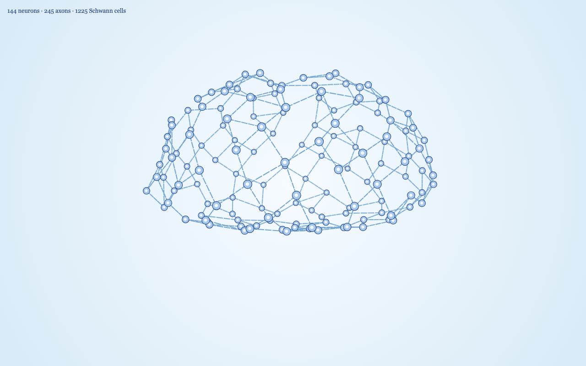

# Brain 3D, v1

A Paper.js drawing of a stylized brain skeleton. Paper.js only draws in 2D, so each neuron is a 3D point. Every frame, the points are rotated around the vertical axis and projected onto the canvas with perspective. Nearer neurons are larger and are drawn on top.



v1 is only the skeleton:

- 144 neurons form a brain-like surface with two upper hemispheres, a shallow sagittal groove, a fuller frontal region, temporal bulges, a tapered rear, and a flattened underside. Change `network.count` in `js/config.js`. The layout is seeded, so the same count always gives the same shape.
- Each neuron connects to its three nearest neighbors. With 144 neurons that gives 245 axons in one connected network.
- Every axon is drawn as five pronounced, rounded Schwann-cell segments with small gaps: 1,225 visible cells at the default settings.
- The skeleton turns at 6 degrees per second (`spin.degreesPerSecond`), one full turn per minute.
- Colors match the awake 2D brain: a light blue radial background, pale blue somas with a dark blue edge, small light nuclei at 0.42 of the soma radius, and blue Schwann cells.

There are no thoughts, no sleep, and no purple crystallization.

## Running it

Paper.js is loaded from a CDN, so serve this folder rather than opening the file directly:

```
cd brain-3d
python3 -m http.server 8123 --bind 127.0.0.1
```

Then open `http://127.0.0.1:8123/`.

## Performance readout

The line at the top left shows the neuron, axon, and Schwann-cell counts, the average time spent updating the scene per frame (rotation, projection, and depth sort, not canvas painting), and the measured frames per second. It refreshes every half second.

Other URL options:

- `?bench=1&frames=600` times 600 frames as fast as possible, including the canvas draw, and prints the average and 95th percentile.
- `?still=1&t=15` draws a single frame 15 seconds into the spin, which is used for screenshots.

Headless Chrome at 1280 by 800, 144 neurons and 245 axons, measured over 600 frames:

| | Average | 95th percentile |
|---|---|---|
| Scene update | 0.35 ms | 0.50 ms |
| Update plus canvas draw | 2.39 ms | 2.90 ms |

That remains well under the 16.7 ms budget for 60 frames per second with 1,225 Schwann-cell paths.

## Files

- `index.html` loads Paper.js 0.12.17 and the scripts.
- `js/config.js` holds the neuron count, brain-shape controls, spin rate, camera, colors, nucleus ratio, and Schwann-cell styling.
- `js/skeleton.js` builds the seeded points, applies the configurable brain-surface warp, and connects nearest-neighbor axons.
- `js/renderer.js` creates the Paper items once, then moves, scales, and reorders them each frame. It evenly interpolates five pooled Schwann segments along every projected axon.
- `js/main.js` sets up the canvas, the frame loop, and the bench and still modes.
