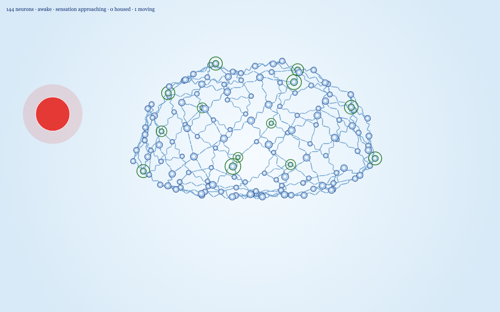
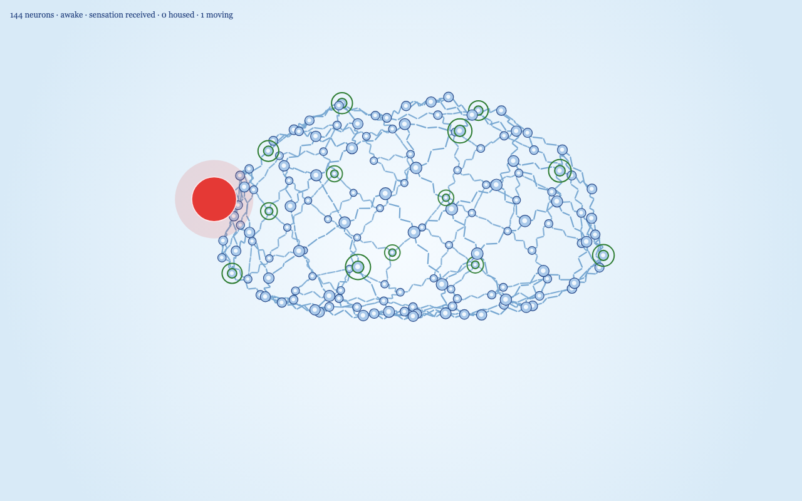

# Brain 3D, v1

A Paper.js drawing of a stylized brain skeleton. Paper.js only draws in 2D, so each neuron is a 3D point. Every frame, the points are rotated around the vertical axis and projected onto the canvas with perspective. Nearer neurons are larger and are drawn on top.


The first stage builds the skeleton:

- 144 neurons form a brain-like surface with two upper hemispheres, a shallow sagittal groove, a fuller frontal region, temporal bulges, a tapered rear, and a flattened underside. Change `network.count` in `js/config.js`. The layout is seeded, so the same count always gives the same shape.
- Each neuron connects to its three nearest neighbors. With 144 neurons that gives 245 axons in one connected network.
- Every axon is drawn as five pronounced, rounded Schwann-cell segments with small gaps: 1,225 visible cells at the default settings. The cells step sideways in a small seeded zigzag instead of sitting on a straight line. The kink is in the skeleton, so it turns with the brain.
- Thirteen thought-domain centers are scattered across the surface with the 2D rule: the same seeded shuffle, then the widest separation that still fits all thirteen. They split into families of 5, 4, and 4, with the repeating weights 0.7, 1.5, 1.0, 1.8, 1.2, 0.6, and 1.4. Each center is marked by a green ring. Every other neuron belongs to the nearest center.
- One complete turn represents ten years of life, so the ten turns from age 0 to 100 take about three minutes. The rotation is deliberately slow in youth and accelerates as the brain fills.
- Colors match the awake 2D brain: a light blue radial background, pale blue somas with a dark blue edge, small light nuclei at 0.42 of the soma radius, and blue Schwann cells.

## External and internal thoughts






One deterministic cohort runs at a time:

1. A large red external sensation appears outside the brain, beyond the outermost neurons, and flies in a straight line toward the brain center.
2. The first contact with a neuron or axon is **sensation received**. The sensation settles onto that strand and rests there briefly.
3. Acceptance is assumed for now, so received is followed by **sensation accepted**. Each sensation has its own seeded size. Youthful receptivity multiplies the size band's original 5, 3, 2, or 1 internal thoughts: at zero saturation the bands launch about 13, 8, 5, or 3 thoughts, while near the saturation ceiling they launch about 2, 1, 1, or 1. On acceptance the sensation travels a random, non-backtracking path and shrinks. Each internal thought starts at 80–105% of that sensation's size and shrinks at its own seeded rate. A fresh thought loses relevance once it is below a quarter of its own starting size, the second halving. A temporary home is exempt and can still settle.
4. Internal routes aim toward different future portions of the external route, with seeded timing variation. Encounters are possible without changing the external sensation's random path.
5. Collision is tested in 3D model space, not in the 2D projection. When a pair overlaps, both are consumed and the nearest neuron becomes a temporary home.
6. The temporary home stops, turns orange, and grows to twice the regular external-thought radius. Unused internal thoughts finish fading before the next cohort starts.

External sensations are scheduled every ten real seconds while awake. The existing single-cohort pool delays an arrival if the previous cohort has not finished, and sleep shuts arrivals down. Once saturation reaches 45%, a largest-band sensation has a seeded 20% chance to become an extreme-distress response, adding a Fibonacci burst of 3, 5, or 8 internal thoughts up to the 13-thought cap.

## Thought-driven life clock

Age belongs to the simulation rather than being inferred from saturation. One turn is ten years, using `age += rotationDegrees / 36`. With normalized fullness `f = saturation / 0.84`, the toilet-roll base speed is `12 + 328 × f^1.35` degrees per second.

Active thought load slows that base speed by `max(0.16, 1 / (1 + 0.35 × load))`. Each traveling internal thought contributes its remaining relative size; a thought migrating during REM contributes half. Five full-sized thoughts reduce time to about 36% of its unloaded speed, and thirteen reduce it to about 18%. Thus youth runs slowly because sensations trigger many thoughts, later life accelerates as saturation rises and receptivity falls, and a rare adult distress burst visibly slows life again.


## Sleep cycle

The night uses the 2D duration rule. Five unsettled homes start an 18-hour night; more unsettled homes shorten it along the 8-hour, 13-hour, and 4-hour anchors, and crystallized homes can only shorten it further. One simulated second represents two hours.

- Fresh awake is a soft morning blue. Sensations are dusty rose, internal thoughts are periwinkle, and temporary homes are apricot.
- Overloaded warms the room toward peach as temporary homes approach the sleep threshold.
- Winding down is pale lilac. No new sensation starts, while a sensation already traveling can still find a temporary home.
- REM sleep is a soft sage. It lasts at least half the calculated night, and longer if a temporary home is still walking to its domain center. Those homes travel at three times the daytime speed, then settle sage at their regular size.
- As each thought reaches its permanent home, it blocks a Fibonacci-sized group of Schwann cells, which turn honey yellow. At low saturation it can claim 34 cells; the largest allowed group falls through 21, 13, 8, 5, 3, 2, and 1 as saturation grows. Selection proceeds clockwise from the permanent-home neuron and expands through neighboring neurons when the local cells are full.
- Deep sleep is a calm indigo and lasts exactly the calculated half, even when REM ran longer. The neurons lighten so they stay visible, and no new thoughts or sensations begin.
- Waking eases from indigo back to morning blue.
- Saturation is the blocked Schwann cells divided by every Schwann cell, with an 84% working ceiling for the speed and receptivity curves. Each permanent thought still claims the saturation-dependent Fibonacci block described above; age advances independently through rotation.


## Running it

Paper.js is loaded from a CDN, so serve this folder rather than opening the file directly:

```
cd brain-3d
python3 -m http.server 8123 --bind 127.0.0.1
```

Then open `http://127.0.0.1:8123/`. The Pause button at the bottom right freezes the thoughts and the rotation; Resume continues from that moment. The space bar does the same while the button is not focused.

## Performance readout

The top left shows age, phase, and sensation state on the first line. The second line shows housed thoughts, moving thoughts, blocked Schwann cells, saturation, current cognitive load, represented years per minute, and scene-update time. It refreshes every half second.

Other URL options:

- `?bench=1&frames=600` times 600 frames as fast as possible, including the canvas draw, and prints the average and 95th percentile.
- `?still=1&t=15` deterministically advances both the thought simulation and spin by 15 seconds, then draws one frame.

Headless Chrome at 1280 by 800, 144 neurons and 245 axons, measured over 600 frames:

| | Average | 95th percentile |
|---|---|---|
| Scene update | 0.72 ms | 0.90 ms |
| Update plus canvas draw | 2.92 ms | 3.60 ms |

That remains well under the 16.7 ms budget for 60 frames per second. Axon and neuron colors are repainted only when the sleep mood or the saturated-cell count changes. The 13-thought pool raises the fixed Paper-item count slightly; the benchmark kept it stable at 1,861.

## Files

- `index.html` loads Paper.js 0.12.17 and the scripts.
- `js/config.js` holds the network, brain-shape, domain, thought, camera, color, and timing settings.
- `js/skeleton.js` builds the brain surface, graph adjacency, shared zigzag edge geometry, and 13 domain centers.
- `js/simulation.js` runs the thought-driven life clock, inbound sensations, saturation-dependent internal bursts, seeded distress events, graph travel, second-half-life fading, housing, and clockwise Schwann saturation with pooled state.
- `js/renderer.js` creates all Paper items once, then projects and depth-sorts neurons and beads while reusing the shared edge geometry.
- `js/main.js` advances the simulation at fixed 1/60-second steps and provides bench and deterministic still modes.
